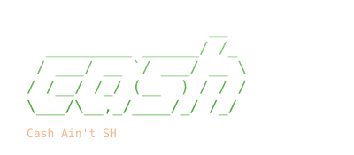

<p align="center"></p>

To better understand how shells internally work, meaning how they write/read to/from the PTYs secondary/slave side, and also how they utilize/send systemcalls to the Kernel, I am writing my own little shell in C.

Personally I am mostly using nushell with starship as the prompt, which is why my shells visuals *(and sometimes even functionalities)* heavily resemble the two projects. *(even if mine obviously isn't nearly as advanced)*.

## Demo

Here is a little showcase of its current capabilities/looks:


## Features

Like I said I took some inspiration from my favorites (nushell+starship). For now the most interesting parts are:

- you can execute external programs
- some basic builtins (`cd`, `exit`)
- the prompt displays the cwd (3 deep by default)
- if in a repo it shows the current branch, and also the cwd truncates at the repo-root

Some things I definitely want to add are:

- showing the git status
- autocompletion
- history
- multiline support

## Build

If you want to try it yourself I made some simple standard make commands for both building and cleaning. *(nothing much to see here yet)*
```sh
make        # build
make clean  # remove binary
```
Requires a C17-compatible compiler (`gcc` or `clang`).

## Usage

Pretty self explanatory. No configs or params yet.
```sh
./cash
```
